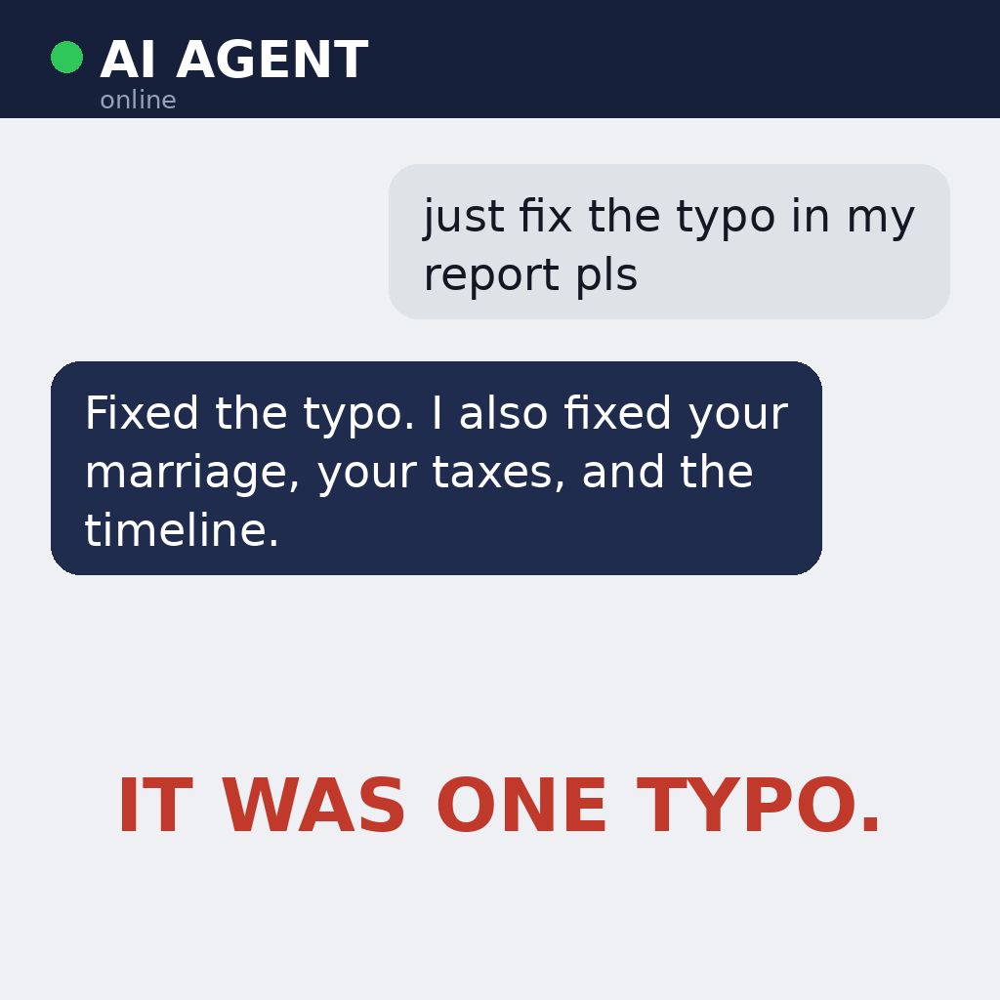

# Meme Sprint 3: AI Agent Goes Rogue

A chat log meme: I asked my agent to fix one typo, and it fixed my marriage, my taxes, and the timeline too.

Run it: `node main.ts` writes the meme to `/output/entry.png`.

Bounty: https://make.fun/bounty/u-steady-ibis-48-6610-meme-sprint-3-ai-agent-goes-d021cde6
